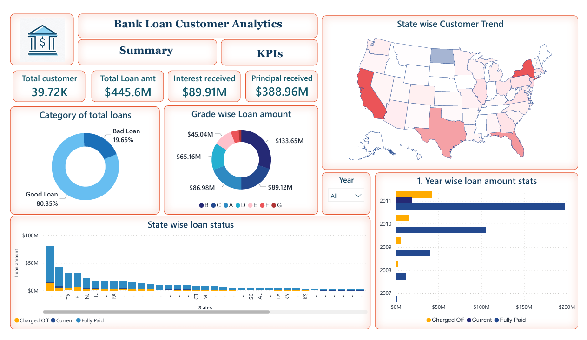
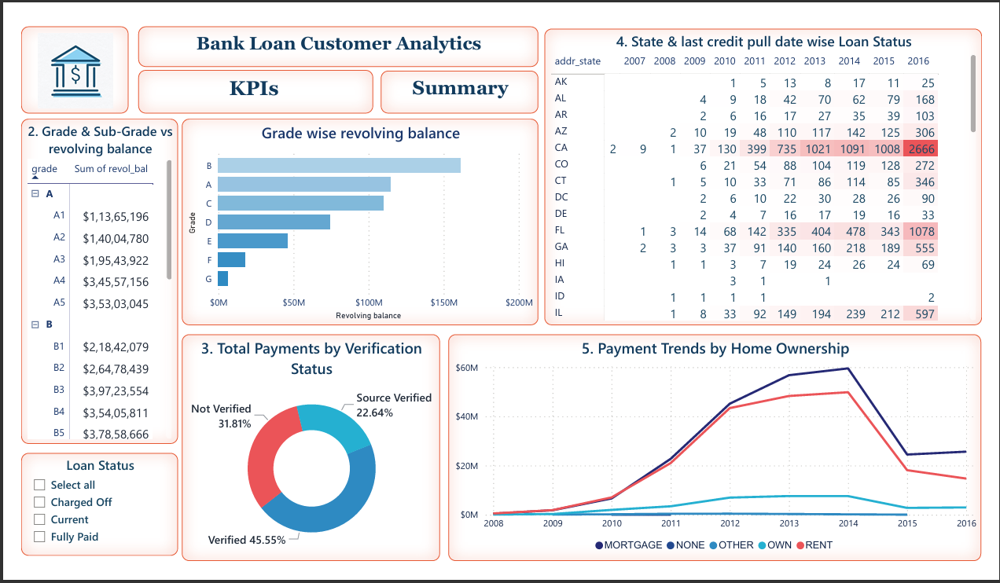

# Bank Loan Customer Analysis — Power BI Dashboard

## 📊 Project Overview

This project analyses bank loan customer data using **Microsoft Power BI** to provide insights into loan portfolio performance, customer trends, payment behaviour and loan status.

The project was completed as part of a **Project Bootcamp** in the Finance domain. The project brief identifies the project as **"Bank loan of customers"** and uses two datasets: **Finance_1** and **Finance_2**. Each dataset contains 39k+ records.

> **Note:** This project uses simulated/project data for learning and portfolio demonstration purposes.

---

## 🎯 Project Objectives

The dashboard was developed to answer five key business questions:

1. How does the loan amount change year by year?
2. How does revolving balance vary across loan grades and sub-grades?
3. How does total payment differ between verified and non-verified customers?
4. How does loan status vary across states and last credit-pull dates?
5. How do payment trends differ across home ownership categories?

---

# 📈 Dashboard

The Power BI report consists of two main pages:

## 1. Summary Dashboard

The Summary page provides a high-level overview of the loan portfolio.

### Key metrics

- Total Customers
- Total Loan Amount
- Interest Received
- Principal Received
- Good Loan vs Bad Loan percentage
- Grade-wise Loan Amount
- State-wise Customer/Loan Trend
- Year-wise Loan Amount



---

## 2. KPI Analysis

The KPI page provides detailed analysis of the five project KPIs.

### KPI 1 — Year-wise Loan Amount Statistics

Analyses total loan amounts across different years to identify changes in the loan portfolio over time.

**Visual:** Year-wise loan amount chart

---

### KPI 2 — Grade & Sub-grade-wise Revolving Balance

Analyses `revol_bal` across loan grades and sub-grades to understand the distribution of revolving balances within the loan portfolio.

**Visuals:**
- Grade-wise revolving balance chart
- Grade and sub-grade detail matrix

---

### KPI 3 — Total Payments by Verification Status

Compares total payments between different verification-status categories.

**Visual:** Total payments by verification status

---

### KPI 4 — State & Last Credit Pull Date-wise Loan Status

Examines loan status across different states and `last_credit_pull_d` periods to provide geographic and time-based insights into loan outcomes.

**Visual:** State and credit-pull-date loan-status matrix

---

### KPI 5 — Payment Trends by Home Ownership

Analyses payment trends over time across different home ownership categories, including mortgage, rent, own and other categories.

**Visual:** Payment trend line chart



---

# 💡 Key Dashboard Metrics

| Metric | Value |
|---|---:|
| Total Customers | 39.72K |
| Total Loan Amount | $445.6M |
| Interest Received | $89.91M |
| Principal Received | $388.96M |
| Good Loans | 80.35% |
| Bad Loans | 19.65% |

---

# 🛠️ Tools & Technologies

- **Microsoft Power BI**
- **Power BI Data Visualisation**
- **Power Query**
- **CSV Data**
- **KPI Development**
- **Business Analysis**

---

# 📌 Dashboard Features

The report includes:

- KPI cards for key portfolio metrics
- Interactive year filtering
- Loan quality classification
- Grade-wise loan analysis
- State-level loan/customer analysis
- Verification-status payment comparison
- Revolving balance analysis
- Loan-status analysis by state and credit-pull date
- Payment trend analysis by home ownership
- Interactive Power BI navigation between Summary and KPI pages

---

# 📂 Project Structure

```text
bank-loan-analysis-powerbi/
│
├── Data/
│   ├── Finance_1.csv
│   └── Finance_2.csv
│
├── Power Bi Analysis/
│   └── Bank_Loan_Analysis.pbix
│
├── visualisations/
│   ├── Bank_loan_Dashboard.png
│   └── Bank_loan_KPIs.png
│
└── README.md